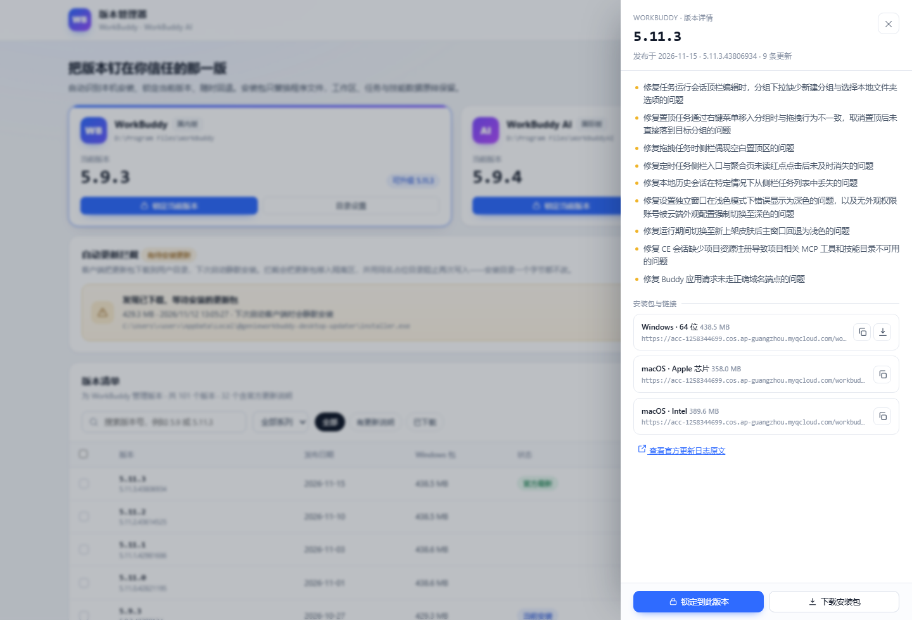

# WB 版本管理器

> 给 WorkBuddy / WorkBuddy AI 一个「留在这一版」的开关：检测当前版本、拦截自动更新、随时回退到任意历史版本，并顺手把安装包链接整理好。

[](#快速开始)
[](#快速开始)
[](LICENSE)
[](#快速开始)

WorkBuddy 桌面端会在后台把完整安装包下载到用户目录，下次启动时静默安装，界面里没有「停在当前版本」的选项。这个工具补上这个开关：**锁定版本 + 隔离更新包 + 一键回退**，并且不动安装目录里的任何文件。


## 功能

- **自动识别两款客户端**：WorkBuddy（国内版）与 WorkBuddy AI（国际版），读取 `install-manifest.json` 得到真实产品版本，而不是根目录的 Electron 版本号。
- **默认锁定当前版本**：一键把正在使用的版本钉住，同时拦截后台更新。
- **拦截自动更新**：把已下载的 `installer.exe` 移入隔离区，并用同名占位目录阻止更新器再次落盘。安装目录零改动，无需管理员权限。
- **版本清单**：内置官方历史版本目录（当前 101 个版本），支持按系列筛选、搜索、标记「当前安装 / 锁定中 / 官方最新 / 已下载」。
- **官方更新说明**：点版本号或「详情」，右侧抽屉展示官网更新日志原文要点，附官方原文链接。
- **下载指定版本**：直接从官方 CDN 下载 Windows 安装包，带进度、速度与断点文件清理。
- **导出 / 复制链接**：单条复制，或多选后批量复制、导出 TXT / CSV / Markdown / JSON，保存到 `exports/`。
- **回退**：用官方 NSIS 静默参数安装任意历史版本；工作区、任务、技能、资料库数据不受影响。
- **版本漂移提示**：锁定后若被其他方式升级，顶部会提示「锁定 x，当前 y」，可一键回退。
- **可选后台守护**：注册计划任务，每 30 分钟检查一次版本漂移。



## 快速开始

要求：Windows 10/11、[Node.js](https://nodejs.org/) 20 或更高版本。无第三方依赖，不需要 `npm install`。

```text
双击  启动工具.bat
```

或手动启动：

```powershell
node server.js
```

浏览器会自动打开 `http://127.0.0.1:17321`（端口被占用时自动顺延）。关闭命令行窗口即停止工具。

## 使用

1. **确认版本**：顶部两张卡片显示两款客户端各自的安装目录与当前版本。
2. **锁定**：点「锁定当前版本」。工具会记录版本、把待安装的更新包移入隔离区，并放置占位目录。
3. **查看更新内容**：在版本清单点任意版本，右侧抽屉显示官方更新日志；「查看官方更新日志原文」可跳转官网。
4. **下载 / 导出**：行内「下载」获取 Windows 安装包；勾选多个版本后可批量复制链接或导出表格。
5. **回退**：在目标版本点「详情 → 安装此版本」，或下载后点「安装」。安装前会关闭客户端并请求一次 UAC 授权。

## 工作原理

### 锁定：隔离更新包，而不是改程序

Windows 上更新器把安装包放在：

```text
%LOCALAPPDATA%\@genieworkbuddy-desktop-updater\installer.exe
```

锁定做两件事：

1. 把已存在的 `installer.exe` 移动到隔离区 `%LOCALAPPDATA%\wb-version-manager\quarantine\`（保留时间戳，不删除）。
2. 在原位置创建一个**同名目录** `installer.exe\`。

目录无法被文件写入覆盖，更新器下一次下载会在最后落盘时失败，而已安装的客户端继续正常运行。`%ProgramFiles%\WorkBuddy*` 里的文件一个字节都没有改，代码签名保持有效。

解除拦截时删除空占位目录，并把最近一个隔离包放回原位（可选）。

> 两款客户端共用同一个更新器缓存目录，因此「拦截」是全局的；版本锁定则按应用分别记录。

### 回退：复用官方安装参数

安装/回退调用官方安装包自带的 NSIS 静默参数，与客户端内置更新服务一致：

```text
installer.exe /S --updated /UPDATE=1 /D=<安装目录>
```

安装器只替换程序文件。以下数据目录不会被触碰：

| 数据 | 路径 |
| --- | --- |
| 用户配置 | `%APPDATA%\WorkBuddy` |
| 工作区、技能、记忆 | `%USERPROFILE%\.workbuddy-ai` |
| 更新器缓存 | `%LOCALAPPDATA%\@genieworkbuddy-desktop-updater` |

安装前会校验安装包 SHA-256（官方更新通道提供时），并记录安装前后版本，写入 `data/state.json`。

## 数据来源

| 内容 | 来源 |
| --- | --- |
| 最新版本与安装包 | `https://copilot.tencent.com/v2/update?platform=workbuddy-win32-x64-user` |
| 历史版本与下载链接 | [官方历史版本页](https://www.workbuddy.cn/docs/workbuddy/Download-History) |
| 更新说明 | [官方更新日志](https://www.workbuddy.cn/docs/workbuddy/Changelog) |

「检查更新」会增量同步：只补抓缺失的版本说明，已有缓存不会被覆盖。目录保存在 `data/catalog.json`，断网也能查看已同步内容。

## CLI（可选）

仓库根目录还带一个零依赖的 PowerShell 版本，适合不想开浏览器时使用：

```powershell
.\wb-vers-manager.ps1 status   # 查看版本、待安装更新、拦截状态
.\wb-vers-manager.ps1 lock     # 隔离更新包并放置占位目录
.\wb-vers-manager.ps1 unlock   # 解除拦截并恢复最近的更新包
.\wb-vers-manager.ps1 list     # 列出隔离区内容
```

CLI 与 GUI 共用同一个占位目录，状态各自记录，互不冲突。

## 目录结构

```text
.
├─ server.js              # 本地 HTTP 服务（仅监听 127.0.0.1）
├─ guard.js               # 版本守护：检查/恢复漂移
├─ lib/
│  ├─ detect.js           # 安装目录与版本识别
│  ├─ catalog.js          # 官方目录增量同步
│  ├─ downloads.js        # 下载管理（进度/取消）
│  ├─ install.js          # 官方静默安装与校验
│  ├─ quarantine.js       # 更新包隔离与占位目录
│  ├─ lock.js             # 锁定状态与计划任务
│  ├─ parse.js            # 官网页面解析
│  └─ store.js            # 状态读写
├─ public/                # 前端（原生 HTML/CSS/JS，无构建）
├─ scripts/
│  ├─ build-catalog.mjs   # 重建官方目录快照
│  └─ dev-screenshot.mjs  # 截图（自动脱敏）
├─ data/catalog.json      # 官方版本目录快照（公开数据）
├─ docs/                  # 截图与说明
└─ 启动工具.bat
```

## 常见问题

**锁定后客户端提示更新失败？**
这是预期行为：更新器无法写入安装包。需要更新时先在工具里解除拦截，或直接安装目标版本。

**会丢工作区或任务吗？**
不会。安装器只写程序目录；工作区、任务、技能与资料库都在用户目录，工具也会在安装前展示这些路径。

**需要管理员权限吗？**
锁定/解除不需要。安装或回退需要一次 UAC 授权，因为要写入 `Program Files`。

**WorkBuddy 和 WorkBuddy AI 的版本为什么可能不同？**
两者共用官方发布通道，但安装时间不同，版本可以不同。工具分别检测、分别锁定。

**为什么不用根目录的 `version` 文件判断版本？**
那是 Electron 的版本（如 `37.10.3-43`），不是产品版本。产品版本在 `resources/install-manifest.json` 的 `appVersion` 字段。

## 数据与隐私

仓库内只包含公开的官方版本目录，不含任何本机用户名、安装路径或使用记录。运行时产生的 `data/state.json`、`store/`、`exports/` 已加入 `.gitignore`；截图脚本在保存前会把 `C:\Users\<name>` 之类的路径替换为 `<user>`。

## 免责声明

非官方社区工具，与 WorkBuddy / 腾讯无隶属关系。请仅在你有权使用的软件上使用。锁定与回退会改变本机客户端版本，操作前请确认当前工作已保存。

## License

[MIT](LICENSE)
