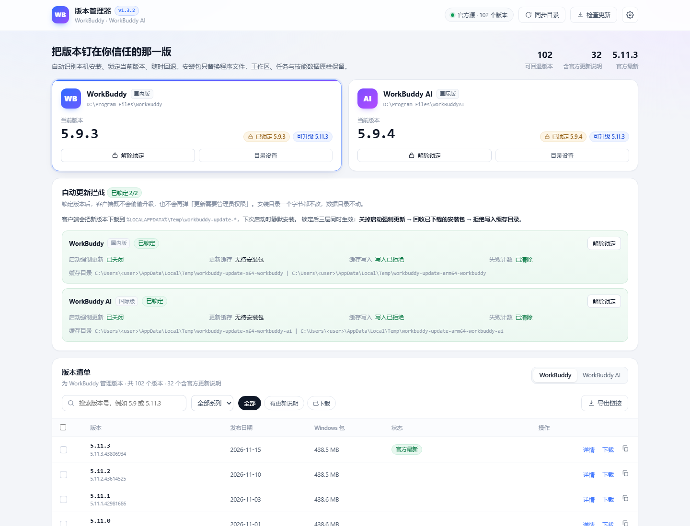
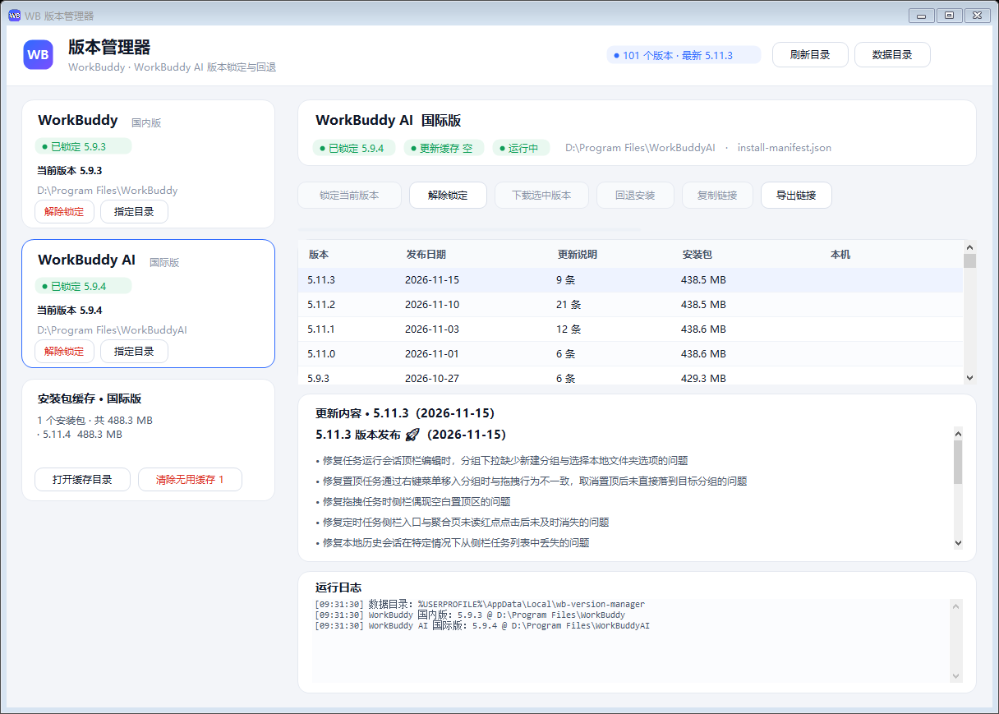

# WB 版本管理器

> 给 WorkBuddy / WorkBuddy AI 一个「留在这一版」的开关：检测当前版本、拦截自动更新、随时回退到任意历史版本，并顺手把安装包链接整理好。

[](#快速开始)
[](#c-客户端桌面版)
[](#网页版)
[](LICENSE)
[](#快速开始)
[](https://github.com/firlsy/wb-version-manager/releases/latest)

WorkBuddy 桌面端会在后台把完整安装包下载到用户目录，下次启动时静默安装，界面里没有「停在当前版本」的选项。这个工具补上这个开关：**锁定版本 + 三层拦截更新 + 一键回退**，并且不动安装目录里的任何文件。

两种前端，功能对齐：

- **C# 桌面客户端**（v1.1.0 新增）：单文件 exe，免安装、免运行时，双击即用；
- **网页版**：Node.js 起一个本地服务，浏览器里操作，适合想直接看源码或用脚本调用的场景。

## 下载

到 [Releases](https://github.com/firlsy/wb-version-manager/releases/latest) 下载（以页面上的最新版本号为准）：

| 文件 | 说明 |
| --- | --- |
| `WorkBuddyVersionManager.exe` | **C# 桌面客户端**，单文件 226 KB，双击即用，不需要安装任何运行时 |
| `wb-version-manager-v1.2.0.zip` | 网页版便携包，解压后双击 `启动工具.bat`（需要 Node.js 20+） |
| `wb-vers-manager-v1.2.0.ps1` | 独立 PowerShell CLI，单文件，不需要 Node.js |
| `SHA256SUMS.txt` | 上面三个文件的校验值 |




## 功能

- **自动识别两款客户端**：WorkBuddy（国内版）与 WorkBuddy AI（国际版），读取 `install-manifest.json` 得到真实产品版本，而不是根目录的 Electron 版本号。
- **默认锁定当前版本**：一键把正在使用的版本钉住，同时关掉客户端的启动强制更新。
- **拦截自动更新**：关启动开关 → 回收已下载的安装包 → 对缓存目录加写入拒绝，三层同时生效。安装目录零改动，不需要管理员权限，也不会再弹「更新需要管理员权限」。
- **版本清单**：内置官方历史版本目录（当前 101 个版本），标记「当前安装 / 已缓存」，支持排序与快速定位。
- **官方更新说明**：选中任意版本即显示官网更新日志原文要点，附官方原文链接。
- **下载指定版本**：直接从官方 CDN 下载 Windows 安装包，带进度、速度与断点文件清理。
- **导出 / 复制链接**：单条复制（三个平台），或导出全部版本的 TXT 清单；网页版还支持 CSV / Markdown / JSON。
- **清理无用缓存**：缓存卡片按客户端分别显示、分别清理，只删掉既不是当前版本也不是锁定版本的安装包；另一个客户端完全不受影响。
- **回退**：用官方 NSIS 静默参数安装任意历史版本；工作区、任务、技能、资料库数据不受影响。
- **版本漂移提示**：锁定后若被其他方式升级，顶部会提示「锁定 x，当前 y」，可一键回退。
- **可选后台守护**：注册计划任务，每 30 分钟检查一次版本漂移。


## 快速开始

### C# 客户端（桌面版）

要求：Windows 10/11。**不需要**安装 .NET 运行时或 Node.js——用的是系统自带的 .NET Framework 4.8。

```text
双击  WorkBuddyVersionManager.exe
```

界面分三块：左侧两张客户端卡片（版本 / 锁定状态 / 一键锁定）、中间版本清单、下方官方更新说明与运行日志。



也支持命令行，方便脚本化：

```powershell
.\WorkBuddyVersionManager.exe --status                # 查看两款客户端的版本与拦截状态
.\WorkBuddyVersionManager.exe --lock workbuddy        # 锁定（workbuddy | workbuddyai）
.\WorkBuddyVersionManager.exe --unlock workbuddy
.\WorkBuddyVersionManager.exe --clear-cache workbuddy # 只清国内版的无用安装包缓存
```

### 网页版

要求：Windows 10/11、[Node.js](https://nodejs.org/) 20 或更高版本。无第三方依赖，不需要 `npm install`。

```text
双击  启动工具.bat
```

或手动启动：

```powershell
node server.js
```

浏览器会自动打开 `http://127.0.0.1:17321`（端口被占用时自动顺延）。关闭命令行窗口即停止工具。


## 使用

1. **确认版本**：顶部两张卡片显示两款客户端各自的安装目录与当前版本。
2. **锁定**：点「锁定当前版本」。工具会记录版本、关掉启动强制更新、把已下载的更新包回收进 `store/`，并对缓存目录加写入拒绝。
3. **查看更新内容**：在版本清单点任意版本，右侧抽屉显示官方更新日志；「查看官方更新日志原文」可跳转官网。
4. **下载 / 导出**：行内「下载」获取 Windows 安装包；勾选多个版本后可批量复制链接或导出表格。
5. **回退**：在目标版本点「详情 → 安装此版本」，或下载后点「安装」。安装前会关闭客户端并请求一次 UAC 授权。

## 工作原理

### 锁定：三层同时生效，安装目录一个字节都不改

从 5.9 起，客户端的自动更新流程是这样的：

1. 启动时读 `app-config.json` 里的 `startupForceAutoUpdate`，为真就执行「早期静默更新」；
2. 定期请求 `https://www.workbuddy.cn/v2/update?platform=workbuddy-win32-x64-user&version=<当前版本>`；
3. 把新版本下载到 `%LOCALAPPDATA%\Temp\workbuddy-update-x64-workbuddy\WorkBuddy-Setup-<版本>.exe`；
4. 下次启动时尝试静默安装，安装目录不可写就弹「更新需要管理员权限」。

只堵第 4 步不够——弹窗会一直出现。所以锁定做三件事：

| 层 | 动作 | 落点 |
| --- | --- | --- |
| 启动开关 | 写入 `startupForceAutoUpdate: false` | `%USERPROFILE%\.workbuddy\app\app-config.json`<br>`%USERPROFILE%\.workbuddy\settings.json` |
| 缓存回收 | 已下载的安装包移入本地仓库，可继续用于回退 | `store/<应用>/WorkBuddy-win32-x64-user-<版本>-recycled.exe` |
| 写入阻断 | 对缓存目录加 `DENY (WD,AD,WEA,WA)` ACL，下载落盘直接 `EPERM`，但保留目录枚举 | `%LOCALAPPDATA%\Temp\workbuddy-update-x64-workbuddy` |

同时清掉 `win-install-failure.json` 里的失败计数——客户端连续失败 3 次或 24 小时内失败过，就会进入「熔断」，每次启动都弹一次管理员权限提示。清掉计数才能真正止住弹窗。

旧版（5.9 之前）的更新器缓存 `%LOCALAPPDATA%\@genieworkbuddy-desktop-updater\installer.exe` 也一并处理：文件移入隔离区，原位置换成同名目录，写入必然失败。

解除锁定时反向操作：删掉 ACL 拒绝项、把 `startupForceAutoUpdate` 恢复成原来的值，已回收的安装包留在 `store/` 里不删。

还原规则有个细节：只有当锁定前这个键**明确是 `true`**（用户自己开过自动更新）才写回 `true`；否则直接删键，让客户端回到自己的默认行为。这样无论上一次是哪个前端锁的，解除之后都真的会恢复更新。

> 两款客户端的缓存目录、配置目录彼此独立，拦截按应用分别记录；旧版更新器目录是共用的，只要还有一个应用处于锁定状态就保持拦截。

### 回退：复用官方安装参数

安装/回退调用官方安装包自带的 NSIS 静默参数，与客户端内置更新服务一致：

```text
installer.exe /S --updated /UPDATE=1 /D=<安装目录>
```

安装器只替换程序文件。以下数据目录不会被触碰：

| 数据 | 路径 |
| --- | --- |
| 国内版配置 | `%USERPROFILE%\.workbuddy` |
| 国际版配置 | `%USERPROFILE%\.workbuddy-ai` |
| 更新缓存 | `%LOCALAPPDATA%\Temp\workbuddy-update-*` |
| 旧版更新器 | `%LOCALAPPDATA%\@genieworkbuddy-desktop-updater` |

安装前会校验安装包 SHA-256（官方更新通道提供时），并记录安装前后版本，写入 `data/state.json`。

## 数据来源

| 内容 | 来源 |
| --- | --- |
| 最新版本与安装包 | `https://copilot.tencent.com/v2/update?platform=workbuddy-win32-x64-user` |
| 历史版本与下载链接 | [官方历史版本页](https://www.workbuddy.cn/docs/workbuddy/Download-History) |
| 更新说明 | [官方更新日志](https://www.workbuddy.cn/docs/workbuddy/Changelog) |

「检查更新」会增量同步：只补抓缺失的版本说明，已有缓存不会被覆盖。目录保存在 `data/catalog.json`，断网也能查看已同步内容。

## 三种入口

| 入口 | 依赖 | 适合 |
| --- | --- | --- |
| `WorkBuddyVersionManager.exe` | 无（.NET Framework 4.8 系统自带） | 日常使用，图形界面 + 命令行 |
| `启动工具.bat` / `node server.js` | Node.js 20+ | 想直接看前端实现、改样式、远程调试 |
| `wb-vers-manager.ps1` | 无（Windows PowerShell 5.1） | 只在终端里做锁定/解除，不装任何东西 |

```powershell
.\wb-vers-manager.ps1 status   # 查看版本、待安装更新、拦截状态
.\wb-vers-manager.ps1 lock     # 关闭启动更新、回收安装包、拒绝缓存写入
.\wb-vers-manager.ps1 unlock   # 解除拦截并还原配置
.\wb-vers-manager.ps1 list     # 列出隔离区内容
```

三个入口操作的是**同一份客户端配置**，可以混用。各自的 `state.json` 只记录自己的操作历史；判断「当前是否已锁定」时以实际配置和 ACL 为准，所以换一个前端打开也不会显示错。

## 目录结构

```text
.
├─ client/                    # C# 桌面客户端
│  ├─ build.bat               # 一键构建（调用系统自带 csc，无需 SDK）
│  └─ src/
│     ├─ Program.cs           # 入口 + 命令行模式
│     ├─ MainForm.cs          # 主界面
│     ├─ Theme.cs             # 配色与自绘控件（圆角卡片/按钮/胶囊/进度条）
│     ├─ NotesView.cs         # 自绘更新说明视图（自动换行 + 滚动）
│     ├─ Json.cs              # 极简 JSON 读写
│     ├─ Core.cs              # 应用画像、路径、格式化
│     ├─ StateStore.cs        # 锁定记录与设置
│     ├─ Detector.cs          # 安装目录与版本识别（含 asar 头部解析）
│     ├─ Catalog.cs           # 官方目录解析与联网刷新
│     ├─ Block.cs             # 三层拦截（配置 / 回收 / ACL）
│     ├─ Download.cs          # 下载与 SHA-256
│     └─ Install.cs           # 官方静默安装与回退
├─ server.js                  # 网页版本地 HTTP 服务（仅监听 127.0.0.1）
├─ guard.js                   # 版本守护：检查/恢复漂移
├─ lib/
│  ├─ detect.js               # 安装目录与版本识别
│  ├─ catalog.js              # 官方目录增量同步
│  ├─ downloads.js            # 下载管理（进度/取消）
│  ├─ install.js              # 官方静默安装与校验
│  ├─ block.js                # 三层拦截实现
│  ├─ lock.js                 # 锁定状态与计划任务
│  ├─ parse.js                # 官网页面解析
│  └─ store.js                # 状态读写
├─ public/                    # 前端（原生 HTML/CSS/JS，无构建）
├─ scripts/
│  ├─ build-catalog.mjs       # 重建官方目录快照
│  └─ dev-screenshot.mjs      # 截图（自动脱敏）
├─ data/catalog.json          # 官方版本目录快照（公开数据）
├─ docs/                      # 截图与说明
└─ 启动工具.bat
```

### 自己构建 C# 客户端

```powershell
cd client
.\build.bat
```

产物在 `dist\WorkBuddyVersionManager.exe`。构建脚本调用 `%WINDIR%\Microsoft.NET\Framework64\v4.0.30319\csc.exe`，并把 `data/catalog.json` 作为资源嵌进去，所以 exe 拷到任何地方都能离线看版本清单。


## 常见问题

**锁定后客户端还弹「更新需要管理员权限 / 自动更新未能完成」？**

那是 `win-install-failure.json` 的失败熔断：客户端失败过一次后，24 小时内每次启动都会重弹。v1.0.1 起锁定会同时清掉这条记录、关掉启动强制更新、拒绝缓存写入，弹窗不会再出现。旧版本请先解除锁定再重新锁定一次，或手动删除 `%USERPROFILE%\.workbuddy\app\win-install-failure.json`。

**锁定后客户端提示更新失败？**
这是预期行为：更新器无法写入安装包。需要更新时先在工具里解除拦截，或直接安装目标版本。

**会丢工作区或任务吗？**
不会。安装器只写程序目录；工作区、任务、技能与资料库都在用户目录，工具也会在安装前展示这些路径。

**需要管理员权限吗？**
锁定/解除不需要——配置写入和 ACL 拒绝都在当前用户权限内完成。安装或回退需要一次 UAC 授权，因为要写入 `Program Files`。

**C# 客户端把数据存在哪？**
`%LOCALAPPDATA%\wb-version-manager\`：`state.json`（锁定记录）、`store\`（下载与回收的安装包）、`catalog.json`（联网刷新后的版本目录）。想换位置可以设环境变量 `WBVM_DATA_DIR`。网页版把同类数据放在项目目录的 `data\` 与 `store\` 下——两边互不覆盖，锁定状态以客户端实际配置为准。

**WorkBuddy 和 WorkBuddy AI 的版本为什么可能不同？**
两者共用官方发布通道，但安装时间不同，版本可以不同。工具分别检测、分别锁定。

**为什么不用根目录的 `version` 文件判断版本？**
那是 Electron 的版本（如 `37.10.3-43`），不是产品版本。产品版本在 `resources/install-manifest.json` 的 `appVersion` 字段。

## 数据与隐私

仓库内只包含公开的官方版本目录，不含任何本机用户名、安装路径或使用记录。运行时产生的 `data/state.json`、`store/`、`exports/` 已加入 `.gitignore`；截图脚本在保存前会把 `C:\Users\<name>` 之类的路径替换为 `<user>`。

## 更新记录

**v1.2.0**
- 缓存卡片新增「清除无用缓存」：只删既不是**当前安装版本**也不是**锁定版本**的安装包，连同未完成的 `.part` 碎片；点之前会列出将删除的文件与可释放空间。
- 缓存按客户端分开：卡片标题显示当前选中的是哪一版，按钮只清这一版的目录，另一个客户端一个字节都不动。命令行对应 `--clear-cache workbuddy | workbuddyai`。
- 「打开缓存目录」现在直接打开当前客户端缓存包所在目录；和网页版放在同一目录时（发行包就是这种结构），两边的缓存会一起统计。

**v1.1.1**
- 修复切换客户端后顶部徽章不刷新：`Badge` / `FlatButton` 是自绘控件，`Text` 变化时不会自动重绘，导致选中 WorkBuddy AI 后仍显示国内版的「已锁定 5.9.3 / 更新缓存 空 / 未运行」。现在文字一变就重绘。
- 徽章宽度改为跟随文字，长文案（如 `更新缓存 3 个 · 1.2 GB`）不再被裁掉，右侧路径标签自动让位。
- 「运行中 / 未运行」改为每 5 秒自动刷新，开了或关了客户端不用手动点「刷新目录」。

**v1.1.0**
- 新增 C# 桌面客户端：单文件 exe，免安装、免运行时，界面与网页版功能对齐，另带 `--status / --lock / --unlock` 命令行。
- 缓存目录的写入阻断从 `DENY (W)` 收窄为 `DENY (WD,AD,WEA,WA)`：依然挡住下载落盘，但保留目录枚举，工具能正常统计缓存内容。
- 解除锁定的还原策略修正：只有锁定前该键明确是 `true` 才写回，否则删键回默认。跨前端锁定/解除不再出现「解了还在锁」。
- 客户端与网页版混用时，锁定状态以实际配置与 ACL 为准，不再依赖各自的 `state.json`。

**v1.0.1**
- 修复锁定后仍弹「更新需要管理员权限」：清掉 `win-install-failure.json` 熔断记录，并关闭启动强制更新、回收缓存安装包、拒绝缓存写入。

## 免责声明

非官方社区工具，与 WorkBuddy / 腾讯无隶属关系。请仅在你有权使用的软件上使用。锁定与回退会改变本机客户端版本，操作前请确认当前工作已保存。

## License

[MIT](LICENSE)
